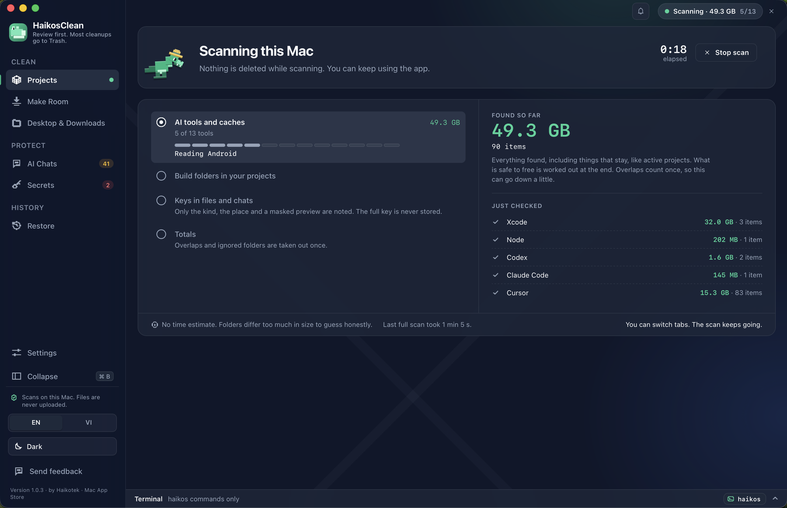

# Haikos Clean

A Mac app that finds and cleans the caches, old agent sessions, and build folders that AI coding tools and developer toolchains leave behind.

You review each item first. Most cleanups go to the Trash, so a wrong pick can come back from Restore.



Haikos Clean is made by [Haikotek](https://haikotek.com/en). It runs on a **Mac with Apple silicon** and **macOS 12 Monterey or later**. Version **1.0.3** is available on the [Mac App Store](https://apps.apple.com/app/id6823184912). This repository hosts **releases and issues only**; the source code is not published here.

## What it cleans

The app scans leftovers from developer and AI coding tools, explains each one, and moves only what you pick. Protected folders are never offered.

**AI coding tools**

- Cursor — caches, update downloads, workspace storage, and agent sessions
- Claude Code — caches and project transcripts
- Codex — downloaded runtimes, older rollouts, and abandoned worktrees

**Xcode and iOS**

- DerivedData and the Swift package cache
- Device Support files
- iOS Simulators (held for 7 days in the Safety Net, restorable until then)
- Archives (also held in the Safety Net)

**JavaScript and web**

- `node_modules`
- npm, pnpm, Yarn, and Bun caches
- Next.js (`.next`), Turborepo (`.turbo`), and `dist` build output

**Other languages and tools**

- Cargo registry cache and Rust `target` folders
- pip cache and Python virtualenvs
- Gradle caches, Android system images, the NDK, and Android AVDs
- CocoaPods cache and `Pods` folders
- Flutter pub cache and SDK
- Homebrew cache
- Docker images (the app asks first; removed images cannot be put back from the Trash)
- Shared app and tool caches
- Large, old files in Desktop and Downloads — moved only when you pick them

Projects that are open in an editor or a coding agent are left alone. iOS Simulators and Xcode Archives wait in the Safety Net instead of going straight to the Trash.

## What it never touches

These are never offered for cleaning:

- Source code
- `.git` folders
- `.env` files
- SSH and GPG keys
- Keychains
- Cloud credentials

## Install

**Requires** a Mac with Apple silicon and macOS 12 Monterey or later. Free to download. The Mac App Store and direct builds are the same app, with a separate purchase for each store.

### Mac App Store

[Download on the Mac App Store](https://apps.apple.com/app/id6823184912)

### Direct download

Get the notarized `.dmg` from [haikosclean.haikotek.com](https://haikosclean.haikotek.com).

Direct checkout is not open yet. If you want a direct license, email [info@haikotek.com](mailto:info@haikotek.com).

### Homebrew (coming soon)

The website lists this command, available once the direct `.dmg` and the `haikotek/tap` tap are published:

```bash
brew install --cask haikotek/tap/haikos-clean
```

Until then, use the Mac App Store or the website.

With Homebrew, the `haikos` command is also on your `PATH`. `haikos clean` prints a plan and exits without deleting anything; add `--yes` to run it.

## Free and Pro

Prices below are from [the pricing page](https://haikosclean.haikotek.com/pro) as of 26 November 2026 (Asia/Saigon). Check that page for the current figures.

Both versions include scan, clean to the Trash, Restore, protected folders, finding secrets, and Desktop & Downloads. Pro is a **one-time purchase**, with a 14-day trial that ends on its own and charges nothing.

| | Mac App Store | Direct download |
| --- | --- | --- |
| Pro price | $19.99 one-time (US price; Apple shows the price for your country) | $19 one-time (USD; tax or VAT may be added) |
| License | Pro on every Mac signed in to your Apple Account, with Family Sharing | One license for up to 3 Macs |
| Trial | 14 days, once per Apple Account | 14 days, once per device |

The direct license keeps working with no renewal. New AI tools are included for 1 year, then $12 / year only if you want more. Purchases stay in their store: an App Store purchase unlocks the App Store version; a direct license unlocks the direct download.

Pro adds unlimited Make Room, saved AI chat copies for every project, unlimited Freeze, hiding a found key in place, your own reclaim rules, and a disk forecast in the menu bar. Autopilot and Agent Bridge are Pro features of the direct download only.

Teams of 5 or more can write to [info@haikotek.com](mailto:info@haikotek.com) about a team license.

## Privacy

Scanning and cleaning run on your Mac. Your files, file names, and scan results are never uploaded. There is no account, no analytics, no advertising, and no tracking.

The app may download a short product notice in your language, and it sends feedback only if you choose to. The direct download also does a license check that you start; no project files are sent. App Store purchases are verified by StoreKit on your Mac.

Full details: [Privacy Policy](https://haikosclean.haikotek.com/privacy).

## Reporting bugs

Please [open an issue](https://github.com/HaikoTek/haikos-clean-app/issues/new) on this repository. A short report is enough if it includes:

- App version (Haikos Clean → About Haikos Clean)
- macOS version
- Which build you are using: Mac App Store, direct download, or Homebrew
- Steps to reproduce, and what you expected

Do not paste secret keys, `.env` contents, license codes, or full chat transcripts.

## Feedback

Use **Send feedback** in the app, or email [info@haikotek.com](mailto:info@haikotek.com). Feature ideas and support questions are welcome there too.

## License

Haikos Clean is a proprietary app by HAIKOTEK COMPANY LIMITED (Công ty TNHH Haikotek). This repository hosts releases and issue tracking; it does not contain the source code.

The Mac App Store version is licensed under [Apple's Licensed Application End User License Agreement](https://www.apple.com/legal/internet-services/itunes/dev/stdeula/). The direct download is covered by the [Terms](https://haikosclean.haikotek.com/terms) and [Refund Policy](https://haikosclean.haikotek.com/refund) on the product site.

## Links

- [Product site](https://haikosclean.haikotek.com)
- [Pricing](https://haikosclean.haikotek.com/pro)
- [Privacy Policy](https://haikosclean.haikotek.com/privacy)
- [Terms](https://haikosclean.haikotek.com/terms)
- [Support](https://haikosclean.haikotek.com/support)
- [Mac App Store](https://apps.apple.com/app/id6823184912)
- [Haikotek](https://haikotek.com/en)
- Email: [info@haikotek.com](mailto:info@haikotek.com)
